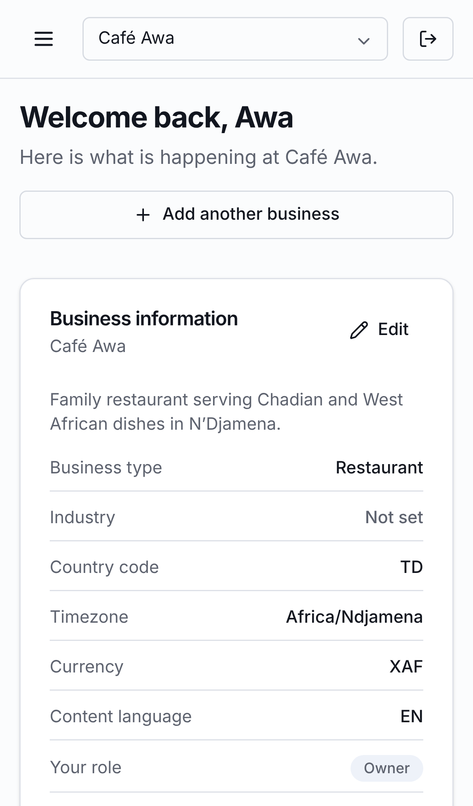
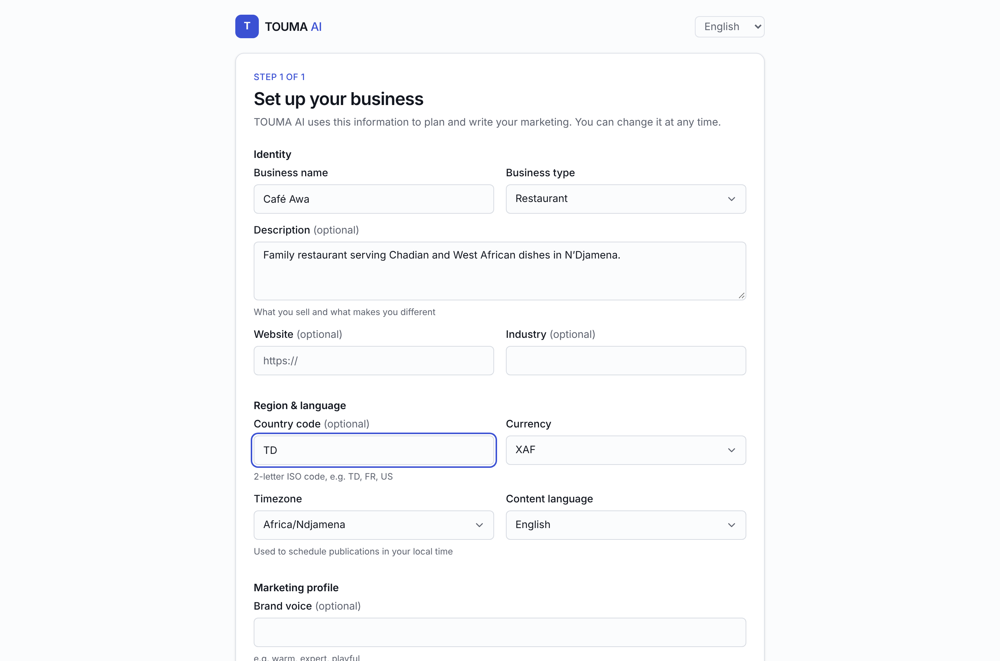
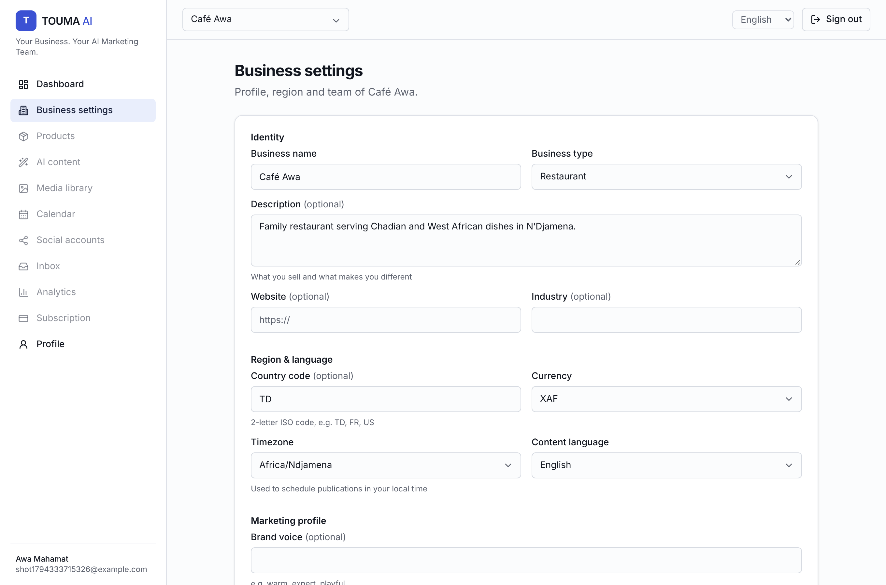

# TOUMA AI — Phase 1 report (Foundation)

*Your Business. Your AI Marketing Team.*

| Dashboard | Mobile |
|---|---|
|  |  |

| Onboarding | Business settings |
|---|---|
|  |  |

## Tasks
| # | Task | Status |
|---|---|---|
| 1 | Monorepo (pnpm + Turborepo) | ✅ |
| 2 | Frontend (Next.js 15, React 19, Tailwind 4, shadcn-style UI) | ✅ |
| 3 | Backend (NestJS 11, `/api/v1`, Swagger) | ✅ |
| 4 | PostgreSQL 16 | ✅ |
| 5 | Prisma + migrations (drift check: no difference) | ✅ |
| 6 | Redis + BullMQ worker + Docker Compose | ✅ (images not built here: no Docker daemon) |
| 7 | Secure registration (argon2id, password policy) | ✅ |
| 8 | Login / logout / logout-all (rotating refresh tokens) | ✅ |
| 9 | Protected routes (API global guard + web auth gate) | ✅ |
| 10 | Roles & permissions (OWNER/ADMIN/EDITOR/VIEWER + platform roles) | ✅ |
| 11 | Business creation & management (create, list, edit, soft delete, members) | ✅ |
| 12 | Multi-tenant isolation (`BusinessAccessGuard`, 404 for non-members) | ✅ |
| 13 | Responsive dashboard (welcome, business info, connected accounts, content overview, upcoming publications, sidebar, user settings) | ✅ |
| 14 | EN/FR translations (catalog-parity test, RTL-ready) | ✅ |
| 15 | Automated tests | ✅ |

## Tests
| Suite | Result |
|---|---|
| Unit: config / shared / api / worker / web | 5 / 12 / 28 / 1 / 5, all passed |
| API integration (real PostgreSQL + Redis) | 56 passed |
| Playwright full stack (desktop + mobile) | 11 passed |
| Typecheck / build | 11/11 tasks, 8/8 tasks |

## Fixed during testing
- **Session lost on fast navigation.** If the browser dropped the refresh response (the user navigated away mid-refresh), the next load presented the rotated token and was logged out. Fix: re-issue within the 10 s grace window (same family, never after logout).
- Clearing an optional business field was silently ignored. Empty strings are now stored as `null`.
- `null` for a required field during an update gave a 500. It now returns a 400.
- An EDITOR could have removed a VIEWER. Removing someone else now requires `members.manage`.
- Form controls were misaligned next to fields with hints, and the dashboard opened scrolled after onboarding.

## Requires credentials
None for Phase 1. OpenAI, S3, Meta, TikTok, Google, Stripe and email are all reported as **not configured** (see `docs/INTEGRATIONS.md`).

## Remaining issues
- Docker images not built in this environment (no daemon). `docker compose config` validates.
- No email provider yet, so no email verification, password reset or team invitations. The members UI lists, re-roles and removes members, but adding new members needs invitations (Phase 2).
- Rate-limit counters live in memory per instance. Switch to Redis storage before running several API replicas.
- No ESLint configuration (strict TypeScript + Prettier only).
- `MAX_OWNED_BUSINESSES` is a fixed abuse cap until plan limits arrive (Phase 10).
