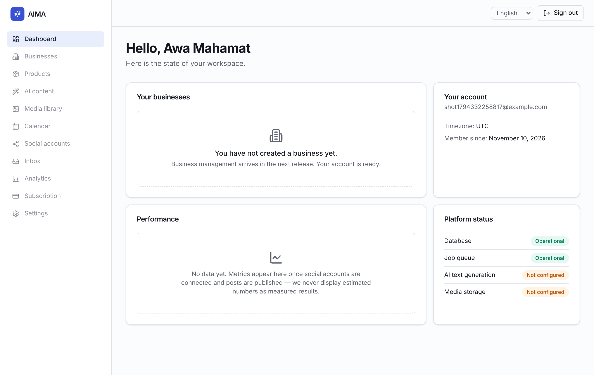

# Phase 1 report — Foundations & authentication



## Implemented
- **Monorepo**: pnpm workspaces + Turborepo; `apps/{web,api,worker}`, `packages/{database,shared,config,ai-engine,social-connectors}`.
- **Infrastructure**: Docker Compose (PostgreSQL 16, Redis 7, MinIO, migrate job, api, worker, web), Dockerfiles that run as a non-root user, and a CI workflow.
- **Database**: the full Prisma schema with all 21 requested models plus `Session`, `ContentMedia` and `KnowledgeEntry`, relations, FKs, unique constraints, indexes, UTC timestamps, Decimal money and soft delete. Initial migration `20261110171718_init`. The seed creates only the 3 plans (19/49/99 USD, configurable).
- **Config**: zod-validated env. The API refuses to boot with weak or missing secrets.
- **API (NestJS)**: `/api/v1` versioning, Swagger, helmet, CORS allow-list, global validation (whitelist + forbid unknown), uniform error envelope, request ids, rate limiting, health/readiness checks with integration status.
- **Auth**: register, login, refresh (rotation + reuse detection), logout, logout-all, me; argon2id; lockout; CSRF header + Origin check; httpOnly SameSite=Strict cookie; audit logs.
- **Users**: `GET/PATCH /users/me` (locale, IANA timezone).
- **Security primitives**: AES-256-GCM `TokenCipher` for OAuth tokens; audit metadata redaction.
- **Shared RBAC matrix** for OWNER/ADMIN/EDITOR/VIEWER (enforced from Phase 2).
- **Worker**: BullMQ maintenance queue with an idempotent job scheduler (expired-session purge) and graceful shutdown.
- **Web**: landing, registration, login and a protected dashboard; EN/FR with an RTL-ready layout; in-memory access token; honest empty states (no fake stats).
- **Contracts** for the AI engine and the social connectors (implemented in Phases 3 and 6).

## Tests (all passing)
| Suite | Result |
|---|---|
| Unit — config | 5 passed |
| Unit — shared (RBAC, schemas, i18n direction) | 6 passed |
| Unit — api (auth service, password, cipher, audit redaction) | 19 passed |
| Unit — worker | 1 passed |
| Unit — web (i18n catalog parity, resolution) | 3 passed |
| API integration (real Postgres/Redis) | 26 passed |
| Playwright full stack | 6 passed |

Migration drift check: `prisma migrate diff` → no difference. Typecheck: 11/11 tasks pass.

## Credentials required
None for Phase 1. OpenAI, S3, Meta, TikTok, Google and Stripe are all reported as **not configured** (see `docs/INTEGRATIONS.md`).

## Known limitations / remaining
- Docker images were not built in this environment because no Docker daemon was available. `docker compose config` validates.
- No email verification or password reset yet (they need an email provider; planned with Phase 2).
- The rate-limit store is in-memory per instance. Switch the throttler to Redis storage before running several API replicas.
- No ESLint config yet (TypeScript strict mode + Prettier only).
- All of Phases 2–10.

## Start
```bash
pnpm install && cp .env.example .env   # replace the secrets
pnpm infra:up && pnpm db:deploy && pnpm db:seed
pnpm build && pnpm dev                 # http://localhost:3000
```
