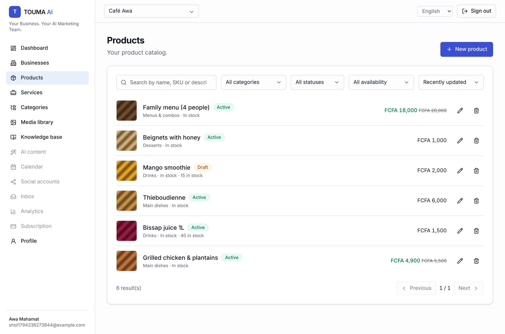
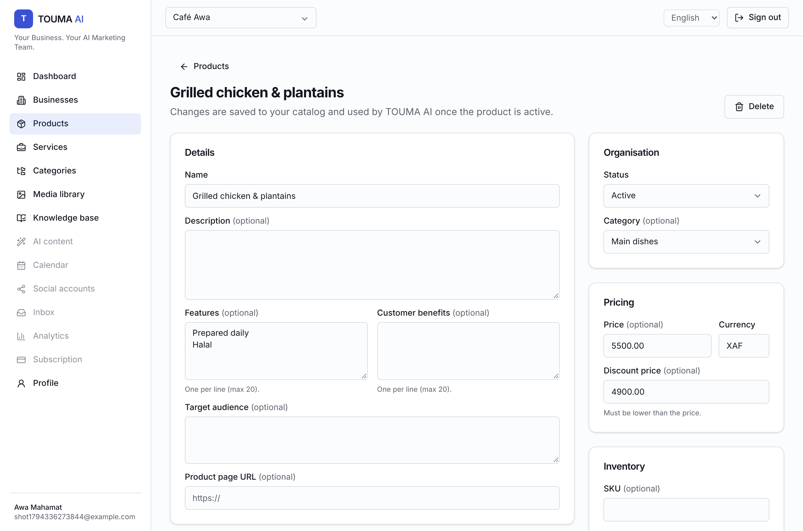
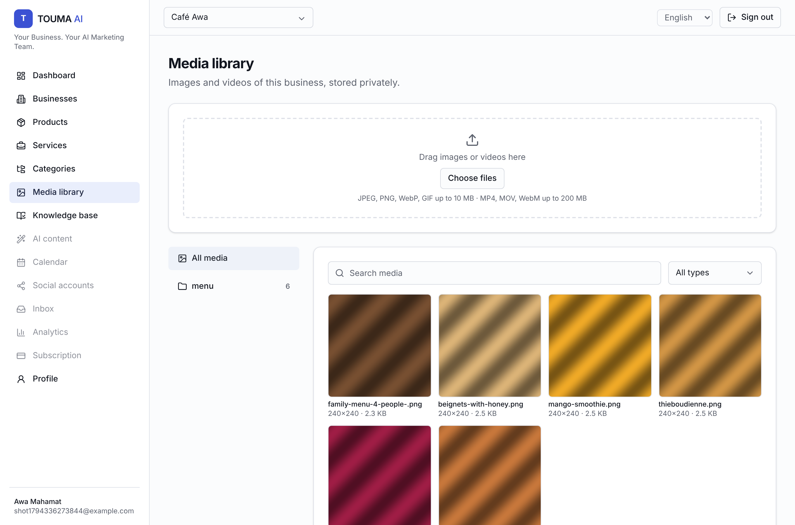
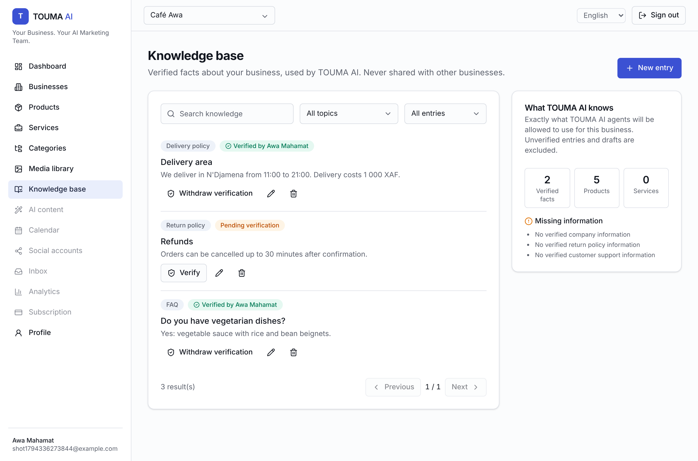
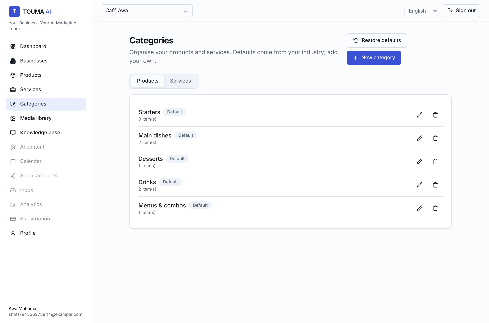
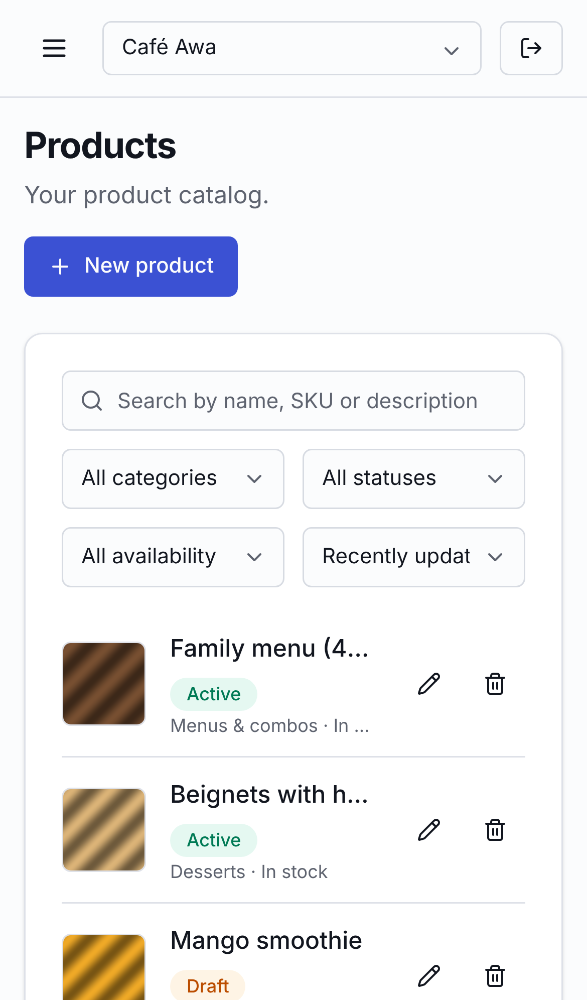

# TOUMA AI — Phase 2 report (Business & product management)

*Your Business. Your AI Marketing Team.*

| Products | Product editor |
|---|---|
|  |  |

| Media library | Knowledge base |
|---|---|
|  |  |

| Categories | Mobile |
|---|---|
|  |  |

## Modules
| Module | Delivered |
|---|---|
| 1. Business management | Create / edit / delete with typed-name confirmation; logo from the media library; description, industry (suggestions + free text), country, city, address, timezone, currency, default language, contact email and phone, website, target audience, objectives; multiple businesses per user with switcher |
| 2. Products | CRUD; images and videos (ordered, cover first); name, description, category, Decimal price, currency (business default), discount price (strictly lower, compared exactly), SKU (unique per business, released on delete), stock (null = not tracked), availability, features, benefits, target audience, URL, status |
| 3. Services | CRUD; description, price, duration, category, target audience, booking information and link, availability and opening-hours notes, status |
| 4. Categories | Separate product and service categories; industry defaults in the business language (EN/FR) created with the business; custom categories; rename; delete keeps items (uncategorised); idempotent "restore defaults" |
| 5. Media library | Streaming multipart upload, magic-byte validation, per-type size limits, dimensions, SHA-256, folders, tags, alt text, previews, usage ("used by"), delete that detaches everywhere, private S3 storage, signed delivery with Range support |
| 6. Knowledge base | Company, product, service, pricing, delivery and return policies, FAQ, customer support; editors write, admins verify, edits reset verification; `context` endpoint = exactly what AI agents will see; missing-information list |
| 7. Frontend | All 9 requested pages plus product/service edit pages and `/dashboard/knowledge`; search, filters, sort, pagination, inline validation, loading, error and empty states, confirmation dialogs, responsive layouts, EN/FR |
| 8. API | `/businesses`, `/products`, `/product-categories`, `/services`, `/service-categories`, `/media`, `/business-knowledge`; DTO validation; Swagger (36 paths) |
| 9. Security | Authentication, membership, permission and resource ownership checked on every operation; cross-tenant 404/400; file validation; credentials never exposed |
| 10. Tests | See below |

## New database models / fields
Migration `20261110181312_phase2_catalog_media_knowledge`:
- **New models:** `Category` (kind PRODUCT|SERVICE), `ProductMedia`.
- **New enums:** `ProductAvailability`, `ServiceAvailability`, `CategoryKind`, `KnowledgeCategory`.
- **Business:** `city`, `address`, `contactEmail`, `contactPhone` (logo uses the existing `logoMediaId`).
- **Product:** `discountPrice` Decimal(12,2), `availability`, `targetAudience`, `categoryId`.
- **Service:** `bookingInfo`, `bookingUrl`, `availability`, `availabilityNotes`, `targetAudience`, `categoryId`.
- **MediaAsset:** `originalFilename`, `folder`, `tags`, `rejectionReason`.
- **KnowledgeEntry:** `category`, `verifiedAt`, `verifiedById`, `createdById`.

New permissions: `media.read` and `knowledge.read` (VIEWER+), `media.write` and `knowledge.write` (EDITOR+), `knowledge.verify` (ADMIN+).

## Tests (all passing)
| Suite | Result |
|---|---|
| Unit: config / shared / api / worker / web | 6 / 26 / 38 / 1 / 8 = **79 passed** |
| API integration (real PostgreSQL + Redis) | **98 passed** (42 new: business, product and service CRUD, categories, uploads incl. spoofed/oversized files, signed URLs, Range, knowledge verification, AI context isolation, RBAC, cross-tenant access, audit) |
| Playwright full stack (desktop + mobile) | **15 passed**, twice in a row (4 new: product lifecycle with photo, services/categories/knowledge, media library and logo, multi-business isolation) |
| Typecheck / build / migration drift | 11/11 · 8/8 · no difference |

Bugs found and fixed while testing:
- **Accessibility:** every dialog shared one element id, so with two dialogs open, screen readers announced the wrong title.
- **Dialogs inside forms:** buttons in a dialog nested in a form submitted the surrounding form (e.g. "Use selected" in the media picker). Dialogs now render in a portal, and `Button` defaults to `type="button"`.
- **Opening dialogs:** a dialog rendered already open did not open once rendered in the portal.

## Storage in this environment
The MinIO download host is blocked here, and running a MinIO binary built from source was not permitted in this session. So:
- The S3 adapter is unit-tested against the AWS SDK with a stubbed client (bucket, keys, private objects, ranges, deletes).
- The full upload → validate → store → serve path is tested end to end with the **test-only** in-memory driver, which the API refuses to start with outside `APP_ENV=test`.
- Docker Compose runs real MinIO for local development; before production, verify once against a real bucket (see Remaining issues).

## Requires credentials
- **S3-compatible storage**: `S3_BUCKET`, `S3_REGION`, `S3_ACCESS_KEY_ID`, `S3_SECRET_ACCESS_KEY` (+ `S3_ENDPOINT` for MinIO/R2). Without them, media endpoints return `503 STORAGE_NOT_CONFIGURED`.
- Everything else in Phase 2 works with no external credentials.

## Remaining issues
- Upload path not yet exercised against a real S3/MinIO bucket from this environment (see above).
- No image re-encoding / EXIF stripping or thumbnails yet (planned in the worker); full-size images are served.
- No malware scanning hook yet; no per-plan storage quota (fixed per-file limits only).
- An object whose deletion fails stays orphaned in storage; a cleanup job is planned.
- Still from Phase 1: no email provider (verification, password reset, invitations), in-memory rate-limit store, no ESLint config, Docker images not built here.
