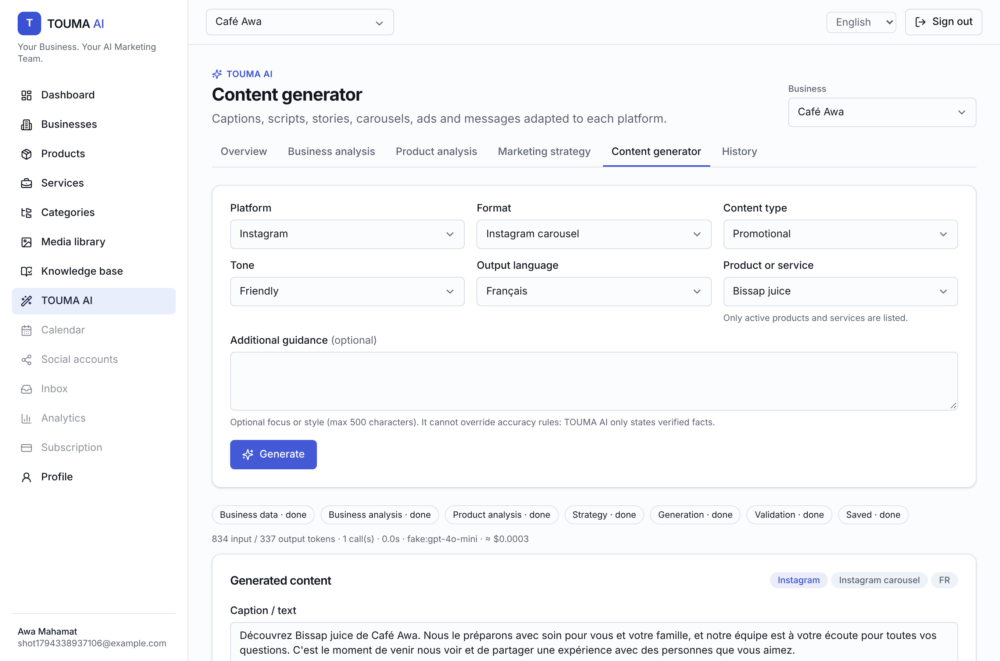
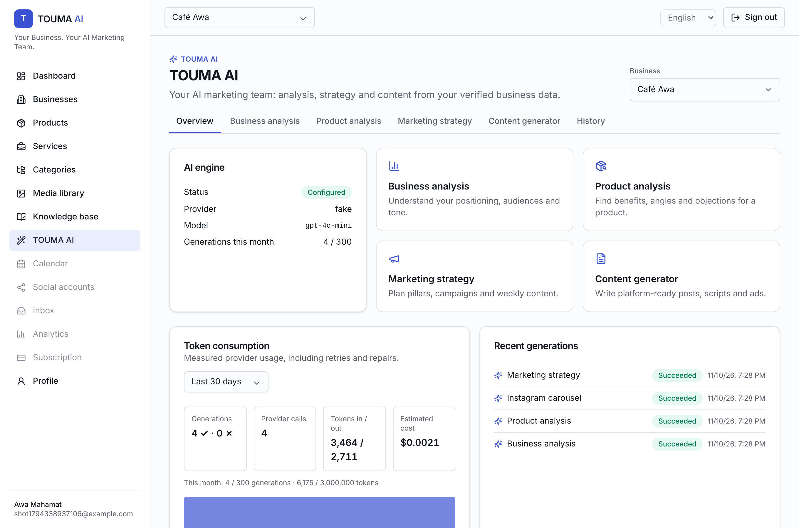
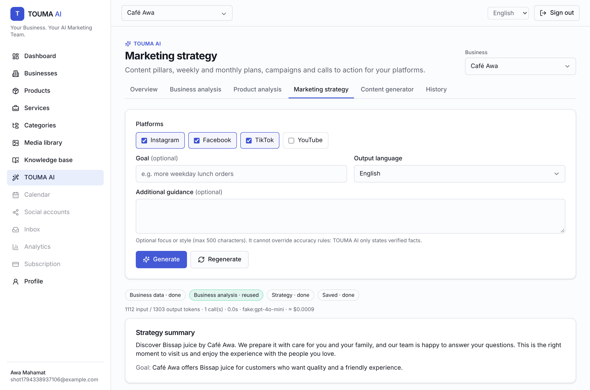
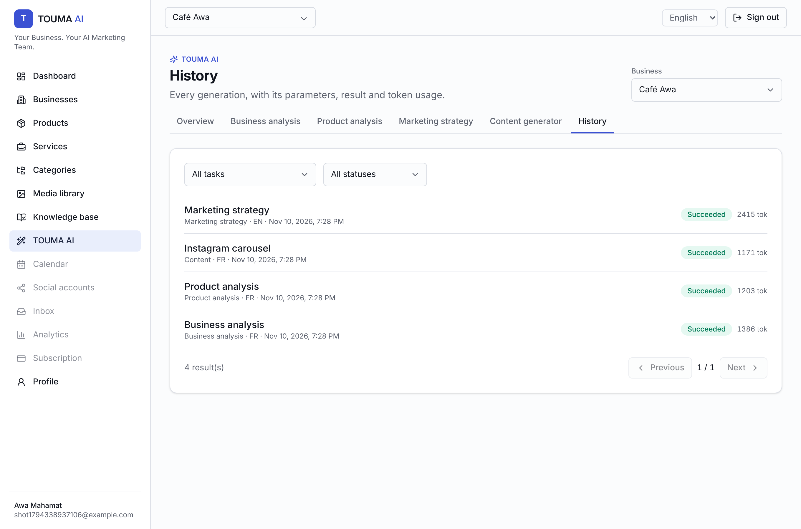

# TOUMA AI — Phase 3 report (Intelligent AI marketing engine)

*Your Business. Your AI Marketing Team.*

| Content generator | Overview & token report |
|---|---|
|  |  |

| Marketing strategy | History |
|---|---|
|  |  |

Screenshots were taken with the **test-only** deterministic provider, so the texts are placeholders, not real model output.

## 1. Implemented agents
Business Analyst, Product Analyst, Marketing Strategist and Content Creator (with platform adaptation for Instagram, Facebook, TikTok and YouTube, plus channel-independent formats), coordinated by the central orchestrator. Details are in `docs/AI.md`.

## 2. New database models
Migration `20261110190749_phase3_ai_engine` (additive):
- **`AIGeneration`**: task, status, item, platform, format, language, tone, purpose, params, instructions, output, edited output, error, provider, model, prompt version, context hash, injection flags, tokens, cost, latency, attempts, parent (regeneration), linked draft content.
- **Enums:** `AITask`, `AIGenerationStatus`.
- **`AIUsage`** (existing table): `generationId` and `attemptKind`, so every provider call is attributed.

## 3. API endpoints
`/api/v1/ai/status`, `/ai/business-analysis`, `/ai/product-analysis`, `/ai/marketing-strategy`, `/ai/content`, `/ai/generations` (+ `/:id`, `/latest/:task`, `/:id/regenerate`, `/:id/draft`), `/ai/usage`. Swagger now documents 47 paths.

## 4. Frontend pages
`/dashboard/ai`, `/dashboard/ai/business-analysis`, `/dashboard/ai/product-analysis`, `/dashboard/ai/marketing-strategy`, `/dashboard/ai/content-generator`, `/dashboard/ai/history`.
- Selectors: business, product/service (active only), platform, format, content type, tone and output language (EN/FR/TR/AR).
- Generate and regenerate (with feedback), an editable result with live platform limits, save draft, and generation history.
- Pipeline steps, per-generation token usage, a token report, and a "not configured" banner.
- Arabic output is edited right-to-left.

## 5. AI provider configuration
All settings come from the environment (see `docs/AI.md`): provider, model, temperature, token and timeout limits, retries, monthly generation and token limits, per-client rate limit, and prices for cost tracking. OpenAI is the initial provider through the `TextModelProvider` interface, so other providers can be added.

## 6. Token consumption reports
`GET /ai/usage` and the overview page show:
- measured tokens in and out per agent, model and day;
- provider calls, including retries and repairs;
- generations that succeeded or failed;
- estimated cost from the configured prices (shown as "price not configured" when the prices are 0);
- month-to-date usage against the limits.

## 7. Test results
| Suite | Result |
|---|---|
| Unit: ai-engine / api / shared / config / web / worker | 53 / 41 / 28 / 7 / 8 / 1 = **138 passed** |
| API integration (real PostgreSQL + Redis) | **132 passed** (34 new AI tests) |
| Playwright full stack | **19 passed**, twice in a row (4 new AI flows) |
| Typecheck / build / migration drift | 12/12 · 8/8 · no difference |

The new tests cover:
- business analysis, product analysis, strategy and content (all 13 formats);
- multilingual output in EN, FR, TR and AR;
- invalid JSON (repaired), fabricated prices and claims (rejected), and platform-limit violations;
- provider failures (rate limit, 5xx, auth) and transient recovery;
- missing credentials (503, nothing stored);
- monthly limits;
- RBAC, cross-tenant isolation, and prompt injection in both user guidance and business data;
- drafts (unedited, edited and invalid edits), regeneration, history and the token report.

**Bugs found and fixed:**
- **Empty "latest" result:** the "latest analysis" endpoint returned an empty body that the web client read as an existing result (a phantom "Regenerate" button). The endpoint now returns `{ generation: null }`, and the client treats empty success bodies as `null`.
- **Refresh rate limit:** the fixed 30/min limit logged users out on 429, which would affect offices behind a shared IP. It is now configurable (`AUTH_REFRESH_THROTTLE_LIMIT`, default 60), and the client retries once instead of signing the user out.
- **Error details:** the error filter dropped `generationId` from failure responses. A small allow-list now passes it through.

## 8. Remaining limitations
- **No real OpenAI calls were made in this environment**: there is no `OPENAI_API_KEY`. The provider is unit-tested against the documented Chat Completions Structured Outputs format with a stubbed `fetch`. Run one generation per agent with a real key before production, and confirm the chosen `AI_MODEL` supports `json_schema` strict mode.
- **Default model:** `gpt-4o-mini` is a configurable default; check that it is still offered before deploying.
- **Validation is rule-based:** grounding catches invented prices, percentages, URLs, unknown sources and common risky claims in 4 languages. It cannot prove every sentence is true, so drafts still require human review (Phase 5 approval workflow). The language check is heuristic.
- **Limits and costs:**
  - Generations run synchronously in the request (up to about 1 minute for a first content generation, which may chain 3 calls); moving them to BullMQ is planned.
  - The monthly limit check isn't atomic under concurrent requests (a small overshoot is possible).
  - Limits are global per business until plan limits arrive (Phase 10).
  - Costs are estimates from configured prices.
- **Analyses are read-only**, though they can be regenerated; generated content is fully editable.
- **Still open:** email provider, Redis-backed rate limits, ESLint, Docker images not built here, S3 not tested against a real bucket.
